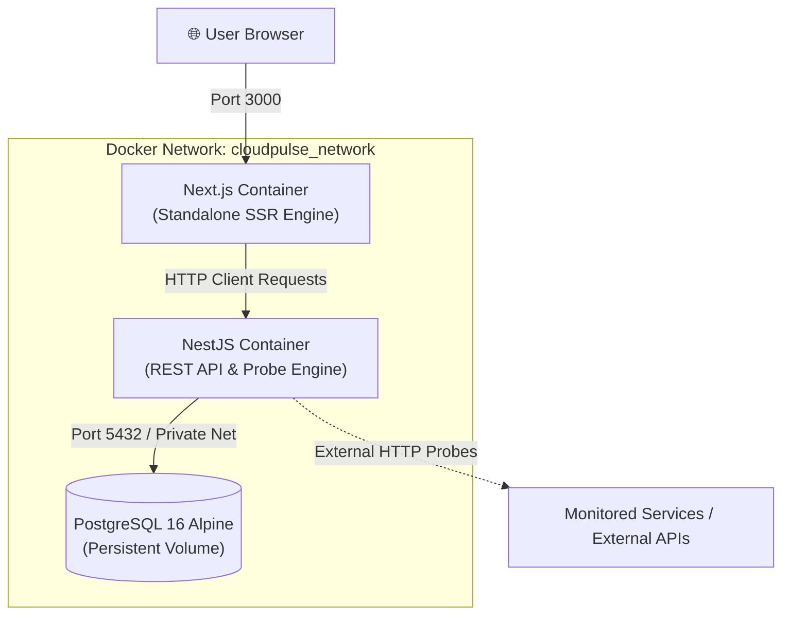

# ⚡ CloudPulse — Distributed Full-Stack Health & Uptime Monitor

> **DevOps Portfolio Project #1:** A production-grade, containerized microservices application built with **Next.js (App Router)**, **NestJS**, **PostgreSQL**, and orchestrated via **Docker Compose**.


---

## 🏗️ Architecture Overview



---

## 🎯 DevOps Engineering Standards Implemented

1. **Multi-Stage Docker Builds (`Dockerfile`):**
   - Separated build stages (`deps` ➔ `builder` ➔ `runner`) to isolate devDependencies and compilers from runtime.
   - Next.js configured with `output: "standalone"` to shrink image size from **~1 GB down to ~80 MB**.
2. **Container Security Hardening:**
   - Switched from root user to non-root `USER node` inside runtime images to prevent container escape privilege escalation.
3. **Container Healthchecks & Resilient Dependencies:**
   - Database has `pg_isready` probe.
   - Backend exposes `/api/v1/health/liveness` via `@nestjs/terminus`.
   - `docker-compose.yml` uses `condition: service_healthy` so backend only boots when PostgreSQL is actively accepting queries.
4. **Isolated Bridge Networking:**
   - All services reside in an isolated private Docker bridge network (`cloudpulse_network`).
   - Container DNS auto-resolution (`db`, `backend`, `frontend`).
5. **Data Persistence:**
   - Named Docker volume (`cloudpulse_postgres_data`) preserves PostgreSQL database state across container rebuilds.
6. **12-Factor Configuration:**
   - Strict separation of config from code via `.env` with `.env.example` template and startup schema validation.

---

## 📁 Repository Structure

```
dockerize-full-stack-app/
├── backend/
│   ├── src/
│   │   ├── config/             # Typed environment configuration
│   │   ├── database/           # TypeORM Entities (Monitor, PingLog)
│   │   ├── health/             # Terminus container health indicators
│   │   └── monitors/           # Probe engine, CRUD service & controller
│   ├── Dockerfile              # Production multi-stage Docker build
│   └── .dockerignore
├── frontend/
│   ├── src/
│   │   ├── app/                # Next.js App Router & modern UI
│   │   └── lib/api.ts          # Typed API client
│   ├── Dockerfile              # Next.js standalone multi-stage build
│   └── .dockerignore
├── docker-compose.yml          # Multi-container orchestration
├── .env.example                # Environment variables template
└── README.md
```

---

## 🚀 Quickstart Guide

### 1. Prerequisites
- Docker Engine & Docker Compose (or Docker Desktop) installed and running.

### 2. Configure Environment
```bash
cp .env.example .env
```

### 3. Launch with Docker Compose
Run all 3 containers with a single command:
```bash
docker-compose up -d --build
```

### 4. Verify Containers Status
```bash
docker-compose ps
```
All containers will display `(healthy)`:
```
NAME                 IMAGE                      COMMAND                  SERVICE    STATUS
cloudpulse_db        postgres:16-alpine         "docker-entrypoint.s…"   db         Up (healthy)
cloudpulse_backend   dockerize-app-backend      "docker-entrypoint.s…"   backend    Up (healthy)
cloudpulse_frontend  dockerize-app-frontend     "docker-entrypoint.s…"   frontend   Up (healthy)
```

### 5. Access the Platform
- **Frontend Dashboard:** [http://localhost:3000](http://localhost:3000)
- **Backend API:** [http://localhost:4000/api/v1/monitors](http://localhost:4000/api/v1/monitors)
- **Container Health Probe:** [http://localhost:4000/api/v1/health](http://localhost:4000/api/v1/health)

---

## 🛠️ REST API Specification

| Method | Endpoint | Description |
|---|---|---|
| `GET` | `/api/v1/health` | Deep healthcheck (Database ping) |
| `GET` | `/api/v1/health/liveness` | Container liveness probe |
| `GET` | `/api/v1/monitors` | List all monitored targets |
| `GET` | `/api/v1/monitors/summary` | Aggregated system metrics (total, down, avg latency) |
| `POST` | `/api/v1/monitors` | Register new endpoint for monitoring |
| `GET` | `/api/v1/monitors/:id` | Get monitor details & historical latency logs |
| `POST` | `/api/v1/monitors/:id/ping` | Trigger immediate manual probe |
| `DELETE`| `/api/v1/monitors/:id` | Remove monitor and cascade logs |

---

## 🛑 Teardown
To gracefully stop the containers:
```bash
docker-compose down
```
To stop and remove persistent database volumes:
```bash
docker-compose down -v
```
